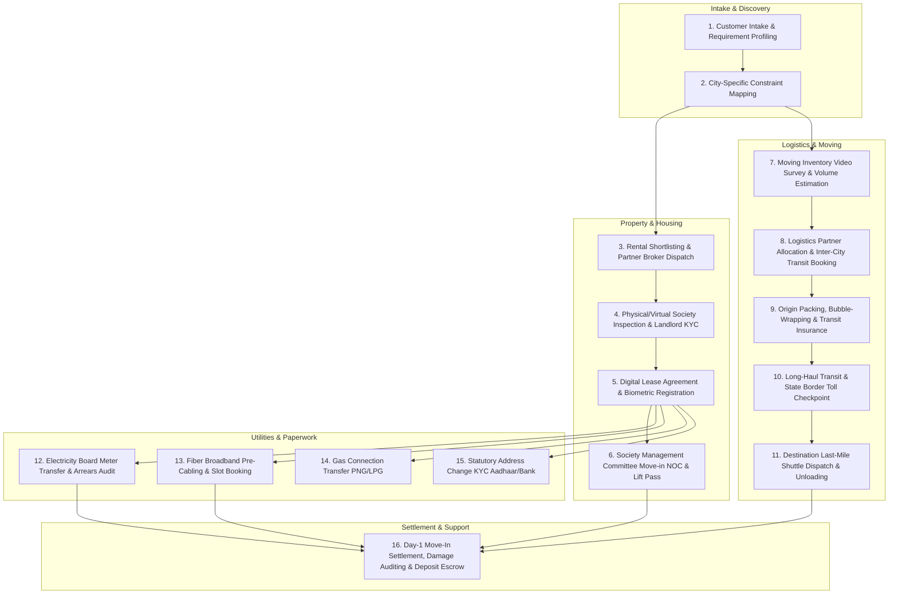

# QuickMove Operations System Map (Submission 1)

**Role:** AI Ops Engineer  
**Company:** QuickMove (StampMyVisa Hiring Assignment)  
**Scale:** 200+ moves/month growing 20% QoQ | 8 Cities | 5 On-Ground Ops Leads  
**Stack Baseline:** WhatsApp groups, shared Google Sheets, Email, No internal engineering team  

---

## 1. System Architecture: The 16 Granular Workflows

Relocation is not a single linear journey; it is a multi-threaded logistics, legal, and utility synchronization challenge with **16 interconnected workflows** across 6 stakeholders.

### The 16 Granular Workflows Detailed

1. **Customer Intake & Relocation Profiling:** Captures family composition, pet requirements, furniture volume, target move date, and corporate relocation allowance caps.
2. **City Constraint & Regulatory Profiling:** Evaluates destination city idiosyncrasies (e.g., Mumbai traffic police truck curfews, Bengaluru society lift deposits, Pune registration index II quirks).
3. **Property Shortlisting & Local Broker Dispatch:** Syncs vetted local brokers in destination micro-markets (e.g., Whitefield, Hinjawadi, Bandra, Gachibowli) to arrange apartment visits.
4. **Physical Inspection & Landlord Background Verification:** Verifies clean title, maintenance dues, water source (Cauvery/tanker/borewell), and pet policies.
5. **Rental Agreement Drafting & Biometric Sub-Registrar Stamping:** Generates legal draft, schedules doorstep biometric scanning for e-registration, and collects digital signatures.
6. **Society Management Committee (MC) Move-in NOC & Elevator Reservation:** Submits tenant bio-data, police verification acknowledgement, and pays refundable freight elevator deposits.
7. **Moving Inventory AI/Video Survey & Truck Sizing:** Audits household goods via video walk-through to prevent vendor day-of-move volume renegotiation.
8. **Logistics Partner Bidding & Slot Allocation:** Matches mover vendor based on route specialization (e.g., SafePack for Delhi $\rightarrow$ BLR, Agarwal for Pune $\rightarrow$ BOM).
9. **Origin Packing, Fragile Crating & Transit Insurance:** On-ground supervisor audits packing quality, labels boxes by destination room, and locks transit insurance coverage.
10. **Inter-City Long-Haul Transit & Checkpoint Monitoring:** Tracks vehicle GPS, state border RTO permits, and green-tax/e-way bill clearances.
11. **Destination Last-Mile Shuttle Dispatch:** If society bylanes prohibit 16ft/19ft containers, transfers goods to small shuttle tempos (Tata Ace) at city perimeter hubs.
12. **Electricity Meter (EB) Name Transfer & Arrears Audit:** Audits prior tenant electricity bills with BESCOM/MSEDCL/TSSPDCL to ensure no power cut during switchover.
13. **Fiber Broadband Provisioning:** Schedules optical fiber technician 24 hours prior to move-in to ensure Day-1 work-from-home readiness.
14. **Piped Gas (PNG) / Cylinder Transfer:** Books Adani Gas/Mahanagar Gas/Indane meter inspection and physical leak test.
15. **Statutory Address KYC Updates:** Updates Aadhaar via UIDAI portal and submits address proof to customer's bank accounts.
16. **Day-1 Settlement, Damage Claim Resolution & Deposit Escrow:** Resolves transit breakage claims within 48 hours and triggers society lift deposit refund collection.

---

## 2. Top 3 Highest-Leverage Automation Opportunities

### Rank #1: Automated Gated Society Gate Pass & Lift NOC Dispatcher
* **Why #1:** In India's top 8 metro cities, **over 60% of moving day disasters happen at the society entrance gate**. Management committees (MCs) refuse truck entry if refundable lift deposits (₹10k–₹25k) are not paid, if the landlord is overseas and hasn't emailed an approval letter, or if the truck arrives after 6 PM. A single blocked truck creates cascading vendor waiting fees (₹1,500/hr) and leaves a family stranded with furniture on the road.
* **The Automation:** An automated workflow that ingests society rules, generates pre-filled indemnity letters for landlords to 1-click sign via WhatsApp OTP, automates QuickMove corporate deposit guarantee slips, and confirms the freight elevator reservation 48 hours ahead.

### Rank #2: WhatsApp Multi-Stakeholder Intelligence & Issue Triage Bot
* **Why #2:** The 5 ops coordinators spend **70% of their day manually copying messages between 4 separate WhatsApp groups per move** (Customer group, Mover group, Broker group, and Internal group). Critical issues (e.g., driver demanding ₹12,000 cash for narrow-lane tempo) get buried in endless chat threads.
* **The Automation:** An AI webhook receiver that parses incoming WhatsApp messages from all groups, automatically tags the move ID, detects emergency sentiment/extortion/delays, drafts the exact response citing contract clauses, and flags an alert on the ops dashboard.

### Rank #3: Pre-Move Ground Access & Truck Sizing Check
* **Why #3:** Logistics vendors routinely quote for standard 17-foot containers. Upon arrival in areas like Pali Hill (Mumbai), Indiranagar (Bengaluru), or Old Gurgaon, local traffic rules or low-hanging overhead cables block container entry. Vendors then exploit the customer by demanding extortionate spot cash for smaller tempos.
* **The Automation:** Automated street access lookup using satellite mapping and historical society database to flag "Narrow Lane Shuttle Required" during initial booking, automatically bundling 2 mini-tempos in the upfront vendor contract.

---

## 3. Workflow Health Metrics

| Workflow | Primary KPI | Operational Target | Red Alert Threshold |
| :--- | :--- | :--- | :--- |
| **Intake to Broker Matching** | Lead-to-First-Viewing Time | $< 24$ hours | $> 48$ hours |
| **Lease & E-Registration** | Registration Turnaround Time | $< 72$ hours from deposit | $> 5$ days |
| **Society Gate Pass & NOC** | Advance Gate Pass Approval Rate | $100\%$ approved 24h prior | Gate pass pending on Move Day |
| **Moving Day Logistics** | On-Time Arrival at Origin/Destination | $\pm 30$ minutes of slot | $> 2$ hours delay |
| **Transit Damage Rate** | Breakage Incident Ratio | $< 2\%$ of total moves | $> 5\%$ of moves |
| **Day-1 Utility Availability** | Wi-Fi & Power Active by 6 PM | $98\%$ Day-1 uptime | Power or Wi-Fi offline on Day 1 |
| **Ops Coordinator Load** | Active Moves per Coordinator | $20 - 25$ moves/FTE | $> 35$ moves/FTE |

---

## 4. Edge Cases & Hidden Failure Modes

1. **The "Sunday Move-In Ban":** Many premium societies in Bengaluru and Mumbai strictly prohibit moving trucks and freight elevator operations on Sundays and national holidays. Amateurs schedule moves for Sunday without checking society bylaws.
2. **The "Previous Tenant Utility Debt Trap":** In cities like Pune (MSEDCL) and Hyderabad (TSSPDCL), electricity meter transfer is blocked if the outgoing tenant left a ₹3,000 unpaid bill. The power company will disconnect supply within 48 hours of month-end unless cleared.
3. **The "Overhead Cable & Low-Hanging Tree Trap":** Container trucks over 11 feet tall frequently tear optical fiber cables in inner Bengaluru or Pune neighborhoods, leading to street fights with local residents and police seizure of the truck.
4. **The "NRI Landlord Timezone Deadlock":** When an NRI landlord in the US or Singapore does not reply for 18 hours to provide digital consent for the society gate pass or gas connection OTP, the on-ground move stalls completely.
5. **The "Monsoon Underpass Submergence":** In Bengaluru (Panathur railway underpass, Kadubeesanahalli) and Mumbai (Milan subway), sudden rains submerge routes. 14ft container trucks cannot take alternate flyovers due to height barriers, requiring dynamic route rerouting.
